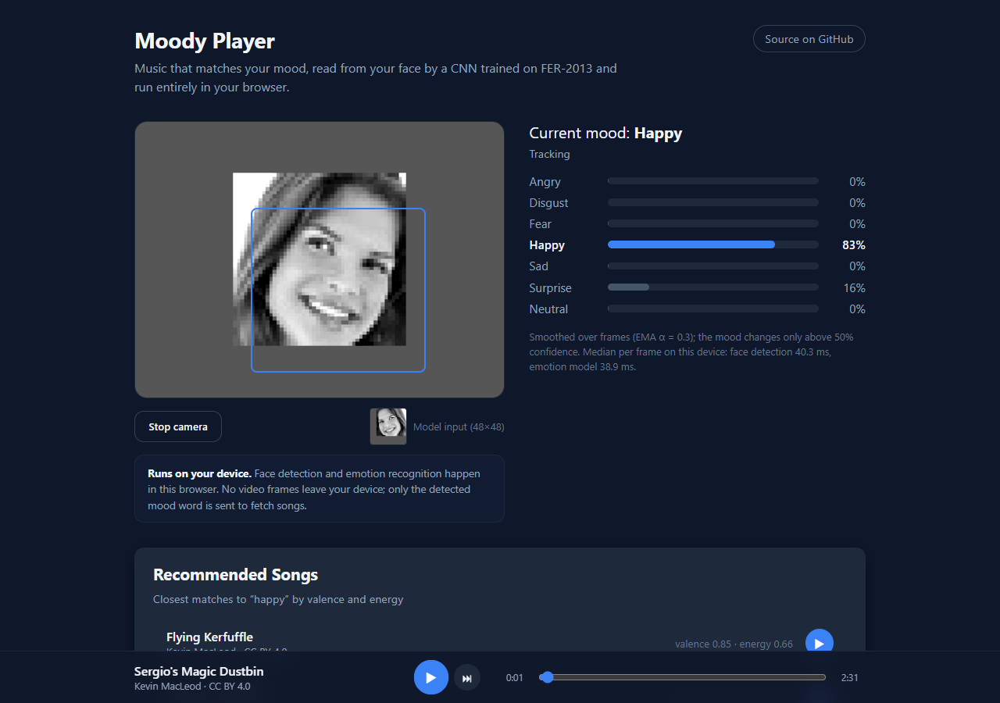
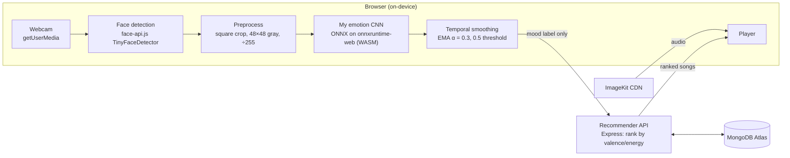
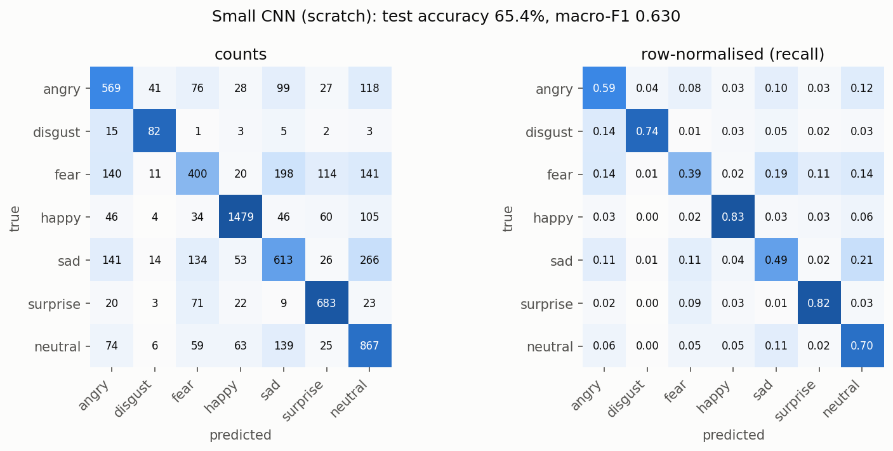

# Moody Player

A music player that reads your facial expression through the webcam and recommends songs that match your mood. The emotion classifier is my own: a CNN trained on FER-2013, exported to ONNX, and run **entirely in the browser**. No video frames ever leave your device.

**Live demo:** [moody-player-taupe.vercel.app](https://moody-player-taupe.vercel.app) (needs a webcam; the free API host may take up to a minute to wake on the first visit)


<sub>Screenshot from an automated test. Chrome's fake camera plays a FER-2013 sample face, so no real person's video is shown.</sub>

## What it does

1. Finds your face in the webcam feed several times a second.
2. Classifies the expression into 7 emotions (angry, disgust, fear, happy, sad, surprise, neutral) with a model I trained, and shows the probabilities live.
3. Smooths the predictions over time, so the mood doesn't flicker with every blink.
4. Ranks songs by how close their **valence** (how pleasant they sound) and **energy** are to the detected mood, then plays them.

## Architecture



Only the mood word (e.g. `happy`) is sent to the server, to fetch songs.

## The model

Training, evaluation and export live in [`ml/fer_train.ipynb`](ml/fer_train.ipynb), which runs on Colab's free T4 GPU. All numbers below are measured in that run and saved in [`ml/results.json`](ml/results.json).

**Data:** FER-2013 (48×48 grayscale faces, 7 classes), using the official train/test split. A stratified 10% of train is held out for validation, giving 25,838 / 2,871 / 7,178 images. The classes are very imbalanced: *happy* has 6,493 training images and *disgust* only 392.

**Training:**
- augmentation: random resized crops, horizontal flips, ±10° rotation
- **class-weighted cross-entropy** (inverse frequency)
- AdamW with cosine learning-rate decay
- **early stopping on validation macro-F1**
- fixed seeds

**Two models compared:**

| Model | Params | ONNX size | CPU latency (ONNX Runtime, 1 thread, median) | Val macro-F1 | **Test accuracy** | **Test macro-F1** |
|---|---:|---:|---:|---:|---:|---:|
| **Small CNN, from scratch** (deployed) | 1,174,439 | 4.70 MB | 2.31 ms | 0.611 | **65.38%** | **0.630** |
| ResNet18, ImageNet transfer learning | 11,180,103 | 44.71 MB | 8.60 ms | 0.621 | 62.47% | 0.609 |

- **Selection rule, fixed before testing:** keep the smaller model unless the larger one wins on *validation* macro-F1 by more than 0.01. ResNet18 led by 0.0094, so the CNN was chosen. On the test set it also turned out better, while being 9.5× smaller and 3.7× faster.
- **Context:** published FER-2013 results are typically 65–73% accuracy, and human accuracy is estimated at about 65%. This model is at the lower end of that range, with 1.2M parameters and a single centred crop (no ensembles or test-time augmentation).

**Per-class test F1 (small CNN):**

| happy | surprise | neutral | disgust | angry | sad | fear |
|---:|---:|---:|---:|---:|---:|---:|
| 0.859 | 0.773 | 0.629 | 0.603 | 0.580 | 0.520 | 0.445 |



### Error analysis

- **sad → neutral is the biggest confusion (21% of sad images).** The model's most confident mistakes are low-intensity expressions, and FER-2013's single crowd label per image is known to be noisy.
- **fear is the hardest class (recall 39%).** It leaks into sad, neutral, angry and surprise. Its cues (raised, pulled-together brows, wide eyes, stretched lips) are small at 48×48 and overlap with the other classes. Many fear → sad mistakes are crying faces that arguably *are* sad.
- **disgust → angry (14%).** Both lower the brows, and disgust has the fewest training images to learn the nose-wrinkle difference from. The weighted loss still gives disgust 74% recall, with lower precision (0.51). No unweighted model was trained, so the gain isn't quantified.
- **happy and surprise are robust (83% and 82% recall).** A smile or an open mouth with raised brows survives downsampling.
- **Training:** the CNN's best validation score came at epoch 54 of a 60-epoch cap, so a longer schedule is the cheapest next experiment. ResNet18 peaked at epoch 8 and overfit quickly.

The full analysis, training curves, per-class F1 chart and examples of misclassified faces are in the notebook and [`ml/figures/`](ml/figures).

### ONNX export, validated

The chosen model is exported to ONNX. The mean/std normalization is baked into the graph, so the browser only has to supply grayscale pixels ÷ 255. All 7,178 test images were run through both PyTorch and ONNX Runtime:
- max logit difference 1.3×10⁻⁵
- **100% identical predictions**
- the same 65.38% accuracy

In the frontend, a unit test checks that **onnxruntime-web** reproduces Python's ONNX Runtime output on the same image.

## In-browser inference

- **Preprocessing matches training exactly:**
  1. square crop around the detected face, widened by 15%
  2. resize to 48×48
  3. BT.601 grayscale, computed with the same 8-bit integer formula PIL uses
  4. ÷ 255

  Using a floating-point grayscale instead shifted probabilities by up to 0.003, so the integer version is used.
- **Loop:** detect → crop → classify at about 5 fps, with a timer that never lets frames overlap.
- **Temporal smoothing:** an exponential moving average, `smoothed = 0.3 · current + 0.7 · previous`, which covers about the last 3 frames (≈0.7 s). The displayed mood only changes when the smoothed confidence is at least **0.5**. That threshold comes from the test-set confidence curve: at ≥ 0.5 the model covers 73% of images with 75% accuracy, at ≥ 0.6 it covers 60% with 80%. Below it, the previous mood is kept.
- **Speed:** the emotion model takes **6.3 ms** per image in Chrome's WebAssembly runtime (single thread, measured on the development PC), against 1.8 ms for native ONNX Runtime on the same machine. The app also shows live per-frame timings for detection and classification.

## Recommendation

Each emotion maps to a target point on **Russell's circumplex model of affect**, with axes valence (unpleasant → pleasant) and energy (calm → excited), both 0–1:

| Emotion | happy | surprise | neutral | sad | angry | fear | disgust |
|---|---|---|---|---|---|---|---|
| (valence, energy) | (0.85, 0.65) | (0.70, 0.85) | (0.55, 0.40) | (0.20, 0.20) | (0.20, 0.85) | (0.15, 0.65) | (0.25, 0.50) |

`GET /songs?mood=happy&limit=10` returns songs sorted by Euclidean distance to the target, instead of requiring an exact mood-tag match. Every mood therefore gets its closest-feeling music, plus near neighbours from other moods. The targets are mood-congruent: they match your mood rather than trying to change it.

**The catalogue:** 28 tracks by **Kevin MacLeod** (incompetech.com) under **CC BY 4.0**, with no copyrighted music. [`backend/scripts/build-seed-manifest.js`](backend/scripts/build-seed-manifest.js) chooses 4 tracks per emotion from the 1,443-track catalogue. Valence and energy are **a transparent heuristic, not audio analysis**: each catalogue "feel" tag (Bright, Somber, Aggressive, …) is placed on the circumplex, then the values are averaged and blended with tempo. [`backend/scripts/seed.js`](backend/scripts/seed.js) re-hosts the MP3s on ImageKit and inserts them; it can be rerun safely.

## Privacy

Face detection and emotion recognition run in your browser through WebAssembly and WebGL. **No video frames, images or face data are uploaded or stored.** The only thing sent to the server is the detected mood word, to fetch songs. The camera stays off until you click *Start camera*, and *Stop camera* releases it.

## Tech stack

| Area | Tools |
|---|---|
| ML | PyTorch, torchvision, scikit-learn, ONNX, ONNX Runtime, Google Colab (T4) |
| Frontend | React 19, Vite 7, SCSS modules, onnxruntime-web 1.30, face-api.js (face detection only), axios |
| Backend | Node.js, Express 5, Mongoose 8, Multer, ImageKit |
| Data and hosting | MongoDB Atlas, ImageKit CDN, Vercel (frontend), Render (API) |
| Testing | `node:test` unit tests, Postman CLI collection, Playwright with Chrome's fake camera (end-to-end checks during development) |

## Project structure

```
frontend/   React app: camera loop, ONNX inference, smoothing, UI and player
  src/lib/  preprocess.js · emotionModel.js · smoothing.js (+ unit tests)
backend/    Express API: ranking, admin-protected upload, seed scripts, Postman collection
ml/         Training notebook, results.json, figures, exported ONNX model
```

## Running locally

Requirements: Node.js 20+ and a MongoDB database (Atlas free tier works). An ImageKit account is needed only for uploading or seeding songs.

```bash
# Backend
cd backend
cp .env.example .env        # fill in MONGODB_URI, ImageKit keys, ADMIN_API_KEY
npm ci
npm run seed                # one-off: load the 28 CC BY tracks (rerun-safe)
npm run dev                 # http://localhost:3000

# Frontend (second terminal)
cd frontend
cp .env.example .env        # VITE_API_URL=http://localhost:3000
npm ci
npm run dev                 # http://localhost:5173
```

**Tests**

```bash
cd frontend && npm test     # preprocessing, smoothing, onnxruntime-web parity
cd backend && npm test      # ranking
postman collection run backend/postman/moody-player.postman_collection.json --env-var adminKey=<ADMIN_API_KEY>
```

**Retraining:** open `ml/fer_train.ipynb` in Colab with a T4 GPU and choose *Run all*. FER-2013 downloads from Kaggle automatically. Copy `onnx/emotion_model.onnx` and `emotion_meta.json` into `frontend/public/models/`.

**Uploading your own song** (protected by the admin key):

```bash
curl -X POST http://localhost:3000/songs -H "x-admin-key: $ADMIN_API_KEY" \
  -F title="..." -F artist="..." -F mood=happy -F valence=0.8 -F energy=0.6 -F audio=@song.mp3
```

## Deployment

- **API on Render:** [`render.yaml`](render.yaml) defines the web service, with root directory `backend`, `npm start` and a health check on `/health`. Set the secrets in the Render dashboard, with `CORS_ORIGIN` set to the Vercel URL. The free tier sleeps when idle. The frontend pings `/health` on load to wake it and says so if the first response is slow.
- **Frontend on Vercel:** import the repo with root directory `frontend` (Vite preset) and set `VITE_API_URL` to the Render URL.
- **Database on MongoDB Atlas:** a free M0 cluster. Network access must allow Render, whose free tier has no static outbound IP.

## Limitations and future work

- FER-2013 consists of web photos, not webcam frames, so live accuracy varies with lighting, camera and pose. Fear and disgust are noticeably harder to trigger than happy or surprise.
- Each model was trained once with a single seed, so there are no error bars.
- Valence and energy come from catalogue metadata rather than audio features or listener ratings.
- Next steps:
  - train longer, since the CNN hit its epoch cap
  - add an unweighted-loss ablation
  - use cleaner FER+ labels
  - add per-class thresholds calibrated on validation data
  - compute audio-based energy features
- Out of scope for this MVP: user accounts, playlists, Spotify integration, fine-tuning on the user's own face, and a user study.

## Credits

- Music: Kevin MacLeod ([incompetech.com](https://incompetech.com)), licensed under [Creative Commons: By Attribution 4.0](https://creativecommons.org/licenses/by/4.0/).
- Dataset: FER-2013 (Goodfellow et al., *Challenges in Representation Learning*, ICML 2013), via [Kaggle](https://www.kaggle.com/datasets/msambare/fer2013).
- Face detection: [face-api.js](https://github.com/justadudewhohacks/face-api.js) TinyFaceDetector.
